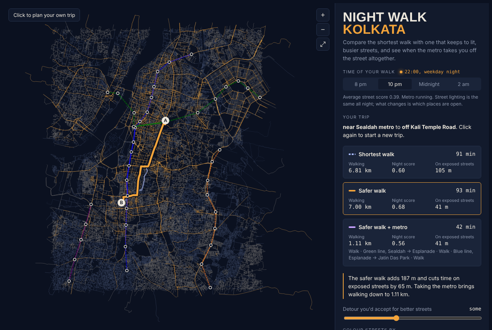

# Night Walk Kolkata

**Which streets are lit and overlooked at 10 pm, and how much longer is the
walk that sticks to them?**

This project scores every walkable street segment in central Kolkata for
night-time exposure, using only open data. It then compares the shortest walk
with a safer one, and with walk + metro while the metro is still running. An
interactive map lets anyone enter a start and destination and see the
trade-off.

**[Open the live map →](https://ananya-fml.github.io/night-walk-kolkata/)**

<!-- RESULTS:START -->


## Results: central Kolkata at 22:00

OSM snapshot of 2 November 2026: **74,288 walkable street segments, 4,434 km**
in a 17 × 13 km box (22.47–22.62°N, 88.30–88.43°E) covering the Kolkata
Municipal Corporation core, the Howrah riverfront and Salt Lake.

**Safer routes are cheap.** Across 200 random trips of 0.8–4 km at 22:00:

| | Shortest walk | Safer walk (β = 3) |
|---|---|---|
| Median distance on exposed streets (score < 0.35) | 525 m | **272 m** |
| Share of walking on exposed streets | 23.7% | **15.3%** |
| Median detour | | **1.2%** (90th percentile 8.4%) |

**After midnight there is little left to divert onto.** The map scores four
hours. Lighting is the same all night; what changes is which places are open
and whether the metro runs. Same 200 trips (`results/by_hour.csv`):

| | 20:00 | 22:00 | 00:00 | 02:00 |
|---|---|---|---|---|
| Network below the exposed threshold | 35.0% | 40.3% | 58.7% | 60.5% |
| Median exposed metres, shortest walk | 440 | 525 | 967 | 1,004 |
| Median exposed metres, safer walk | 213 | 272 | 627 | 692 |
| Metro | running | running | closed | closed |

Before 22:00 a safer route roughly halves exposure. After midnight it cuts
only about a third, because the busy streets it would divert to have
emptied too. For late-night trips, route choice matters less than whether
there is any service at all.

**The result does not hinge on the weights.** Moving any one weight by ±0.15
keeps segment rankings almost identical (Spearman ρ 0.976–0.998), and 82–93%
of chosen routes do not change at all (`results/weight_sensitivity.csv`).

**OpenStreetMap barely describes Kolkata at night.** This is the main finding.

| Evidence | Coverage |
|---|---|
| Segments with a `lit=*` tag | 0.5% |
| Street lamps mapped in the whole area | 20 |
| Places with `opening_hours` | 15.1% of 3,010 |
| Segments with any mapped place within 50 m | 14.7% |
| Segments with VIIRS radiance (district-masked raster) | 77.9% |

So most scores rest on priors. Length-weighted confidence is 0.35 out of 1.

**Where data is thin, it is thin in the wrong places.** Across 271 one-km
cells, confidence correlates with night-time radiance at **ρ = 0.63**. The
index is least informed in darker, more peripheral areas, which are exactly
where a night-time walker most needs it. A routing tool built on volunteered
data inherits this bias silently unless it reports confidence.

**OSM has almost no negative lighting evidence.** 89 streets are tagged
`lit=yes` and 2 are tagged `lit=no`: mappers record lit streets, not dark ones.
So the lit-tag versus satellite check cannot be run (`nightwalk.evaluate`
declines with fewer than 10 streets in a group). Absence of a tag is not
absence of light.
<!-- RESULTS:END -->

## What the score measures

Each segment gets three components in [0, 1]:

| Component | Weight | Evidence used |
|---|---|---|
| **Lighting** | 40% | OSM `lit=*` tag, else mapped street lamps within 20 m, else a road-class prior blended with VIIRS night-time radiance |
| **Activity** | 35% | Places within 50 m that are **open at the chosen hour**, read from OSM `opening_hours`; where hours are missing, a category prior (e.g. restaurants 0.6, banks 0); where no place is mapped at all, a low road-class prior (absence in OSM is not evidence of an empty street) |
| **Street context** | 25% | Road class, reduced for frontage lost to parks, rail land, water, wetland, industrial or vacant land (within 30 m), and for underpasses |

Activity is computed for four hours: 20:00, 22:00, midnight and 02:00. Parsed
`opening_hours` are evaluated at each hour; the category priors, written for
22:00, are scaled by hour (×1.6 at 20:00 down to ×0.15 at 02:00), except for
hospitals, hotels and police stations. A police station or hospital within
150 m adds a small bonus. The weights are
modelling choices, stated in `src/nightwalk/config.py` and tested in the
sensitivity analysis below.

**This is an exposure index, not a crime map.** It describes how lit,
overlooked and busy a street is likely to be. It says nothing about who is on
it, and it should not be read as a statement about any neighbourhood's people.

### Confidence

Every component also carries a **confidence**: how much of it rests on direct
observation rather than a prior. A `lit=yes` tag scores 1.0; a road-class
guess scores 0.15–0.3. For activity, confidence is the share of nearby places
whose opening hours were actually parsed. The segment confidence is the
weighted mean.

The map can colour streets by confidence instead of score. That view shows
where the index is mostly guessing, which is where it should be trusted least.

## Routing

Walking cost is generalised time:

```
seconds_walked × (1 + β × (1 − score))
```

β = 0 is the shortest path. The default β = 3 makes a fully dark segment cost
four times its length. The map's slider varies β.

The walk + metro option adds the metro lines and stations from OSM route
relations, with a boarding wait (half a late-evening headway), in-vehicle time
and transfer penalties. It is offered only inside the service window
(`METRO_SERVICE_START`–`METRO_SERVICE_END`, 06:00–22:30), so it disappears
from the map at midnight and 02:00.

## How far can it be trusted? (no ground truth)

There is no city-wide record of how safe streets feel at night, so
`nightwalk.evaluate` runs the checks that do not need one:

1. **Route effect.** Over random 0.8–4 km trips: how often the safer route
   differs, the detour it costs, and the exposed distance it saves.
2. **Weight sensitivity.** Each weight moves ±0.15. Rank correlation of
   segment scores and overlap of chosen routes show whether conclusions depend
   on arbitrary choices.
3. **Convergent validity.** Where a street carries `lit=yes` or `lit=no`, does
   VIIRS radiance separate the two (AUC)? Do the three components carry
   different information (inter-component correlation)?
4. **Coverage bias.** Mean confidence on a 1 km grid, and its correlation
   with night-time radiance. If the index is mostly guessed in darker,
   poorer or peripheral areas, it will steer people worst exactly where it
   matters most. This is the central open problem.

### How this should be validated properly

- **Perception survey.** Short in-situ ratings at a stratified sample of
  segments (high/low score × high/low confidence), at night, with a balanced
  panel of respondents including women and late-shift workers.
- **Street-level imagery.** Night-time imagery (Mapillary, or a dashcam
  drive) to estimate lighting and open frontage independently of OSM,
  checking the lighting component and the category priors.
- **Field audit of opening hours.** A walk-through of a sample of streets at
  22:00, recording which shops are actually open. This estimates the priors
  rather than assuming them.
- **Missing-data bias.** Comparing confidence against ward-level census or
  slum indicators to test whether OSM completeness tracks deprivation.

## Running it

```bash
pip install -e .[test]
pytest -q                                   # synthetic city, no download

python -m nightwalk.fetch                   # OSM snapshot via Overpass -> data/raw/
python -m nightwalk.pipeline --ntl kolkata_ntl_median_500m.tif
# Exact zeros in the raster are treated as missing (district-masked rasters
# are zero-filled outside the boundary).
python -m nightwalk.evaluate                # route effect, sensitivity, coverage
python scripts/build_web.py web/data.json web/index.html \
    --demo "88.3700,22.5675,Sealdah" "88.3426,22.5204,Kalighat Kali Temple"
```

`web/index.html` (about 9 MB) is self-contained: open it in a browser or serve
it with GitHub Pages. Routing runs in the browser, so no server is needed.

### Using the map

- **Type a start and destination.** The search box suggests from a built-in
  index of 4,406 names (streets, shops, hospitals, colleges, temples, metro
  and railway stations), so it works offline. When online, "Search
  OpenStreetMap" looks up any other address through Nominatim, limited to
  the mapped area. Coordinates (`22.5726, 88.3639`) work too. You can also
  click the map, or use your location.
- **Pick the hour** (8 pm to 2 am) and how much detour you'd accept.
- **Map detail** (buildings, water, parks, place names) comes from basemap
  tiles, with the scored streets drawn between the base and the labels. By
  default this is Esri's keyless Dark Gray Canvas. For CARTO's Dark Matter
  map, request a free key at <https://carto.com/basemaps/apikey/> and paste it
  into `web/config.js`; no rebuild is needed. The ▦ button turns the basemap
  off. Where tiles cannot load, the map still works on the street network
  alone.

## Repository layout

```
src/nightwalk/
  config.py      study area, weights, priors, routing parameters
  fetch.py       Overpass queries (streets, lamps, places, transit, land use,
                 neighbourhoods and landmarks for search)
  network.py     walkable graph from raw OSM, split at junctions
  features.py    lamps, open places, isolation, guardians, VIIRS per segment
  score.py       components, score and confidence
  transit.py     metro stations and line sequences from route relations
  route.py       shortest / safer / walk + metro routing
  evaluate.py    validation checks without ground truth
  export.py      compact graph bundle and search index for the browser
web/template.html  the map: canvas renderer, basemap tiles, search, Dijkstra
tests/           synthetic city and 27 tests
results/         evaluation outputs for the Kolkata run
```

## Limitations

- OSM coverage of `lit`, street lamps and `opening_hours` in Kolkata is
  sparse, so much of the score rests on priors. The confidence layer exists
  to make that visible.
- A snapshot, not live data: four fixed hours of a weekday night, from one
  OSM download. Festivals, power cuts and monsoon flooding change the night
  street completely, and the hourly scaling of the priors is an assumption.
- Footpath availability, encroachment, stray dogs and police patrols are not
  in the data.
- Metro service is assumed to end at 22:30, the last weekday departure on the
  Blue and Green lines reported in July 2026; Purple and Orange are not
  confirmed. Waits use a fixed half-headway. Buses and shared autos are not
  modelled yet.
- VIIRS at 500 m describes neighbourhoods, not streets; it only adjusts the
  lighting prior and never overrides a tag.

## Data

© OpenStreetMap contributors (ODbL). Basemap tiles © Esri, HERE, Garmin, or
© CARTO when a CARTO key is set. Online search by
Nominatim (OpenStreetMap), used lightly and only on request. VIIRS night-time
lights from the Earth Observation Group, Payne Institute. No personal data is
used; "use my location" stays in the browser.

## Licence

Code: MIT. See `LICENSE`.
